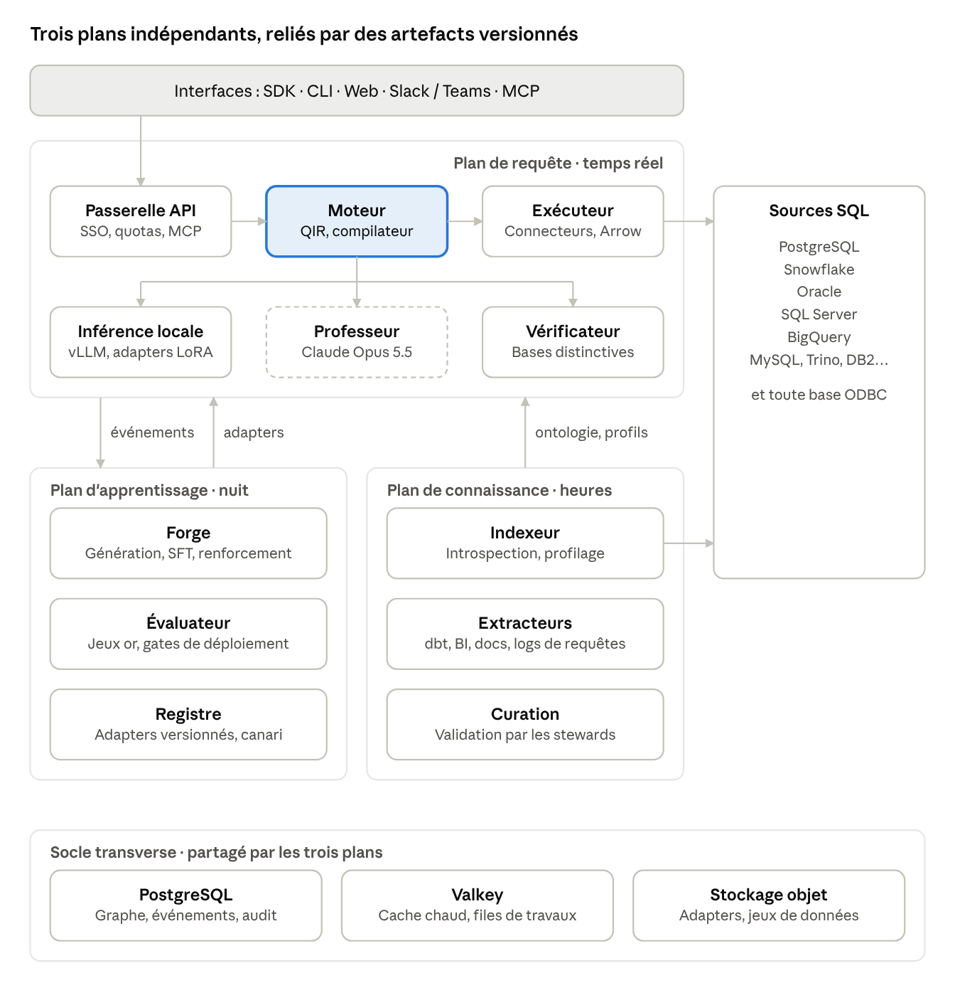
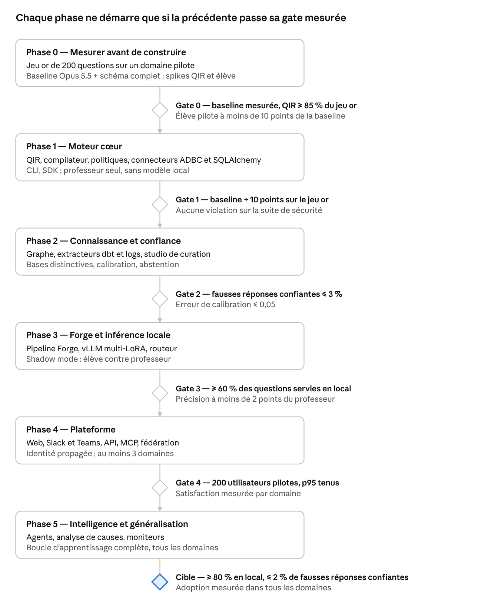

# Qraft — Spécification d'architecture

Nov 11, 2026 · @Mohamed TRAORE

## Résumé exécutif

Qraft est une plateforme interne d'intelligence de données. Un collaborateur y pose une question en français et reçoit une réponse chiffrée, vérifiée, expliquée et traçable, quelle que soit la base SQL de l'entreprise interrogée. Le moteur est écrit en Python. Les chemins chauds reposent sur des bibliothèques natives : Arrow, DuckDB, SQLGlot compilé, vLLM.

Trois ruptures le distinguent des outils text-to-SQL actuels :

1. **Chaque base est compilée en un modèle spécialisé.** Une usine, la Forge, génère des dizaines de milliers de paires question → interprétation → SQL, vérifiées par exécution. Elle entraîne ensuite un petit modèle local par domaine (adapter LoRA). Le grand modèle cloud devient un professeur, appelé seulement pour les cas difficiles.
2. **Le modèle ne produit pas de SQL mais une interprétation typée.** Un compilateur multi-passes la transforme en SQL dialectal (QIR → plan logique → AST). L'utilisateur voit l'interprétation et peut la corriger. C'est elle qu'on met en cache, qu'on vérifie et qu'on fait apprendre.
3. **La confiance est calculée, pas supposée.** Les candidats sont comparés sur des bases synthétiques construites pour les départager. Un désaccord devient une question de clarification, illustrée par un contre-exemple concret. Le système sait s'abstenir.

Chiffres cibles, à valider par les spikes de la phase 0 (aucun n'est encore mesuré) :

| Indicateur | Cible |
| --- | --- |
| Précision d'exécution sur le jeu de référence interne (questions répondues) | ≥ 90 % |
| Réponses fausses affirmées avec confiance | ≤ 2 % |
| Questions servies sans appel cloud, après 3 mois d'apprentissage | ≥ 80 % |
| Latence p50, chemin local, hors temps base | < 1 s |
| Latence p95, chemin professeur, hors temps base | < 12 s |

Décisions structurantes :

- architecture hexagonale ;
- Arrow comme format unique de données ;
- métadonnées et graphe de connaissance dans PostgreSQL ;
- inférence locale via vLLM multi-LoRA ;
- Claude Opus 5.5 comme professeur ;
- sécurité appliquée par la base (identité propagée, RLS native), puis par le compilateur, jamais par le prompt.

## Vision, rupture et principes

Un text-to-SQL d'entreprise échoue sur le sens, pas sur la syntaxe. Qraft compile donc l'entreprise à l'avance : ses données, son vocabulaire, ses habitudes de requête. À l'exécution, il ne reste que trois choses rapides : retrouver, inférer avec un modèle spécialisé, vérifier.

### Ce qui change par rapport à l'état de l'art

| Aspect | Approche courante (RAG + prompt) | Qraft |
| --- | --- | --- |
| Connaissance de la base | Schéma injecté dans le prompt à chaque requête | Apprise dans les poids d'un modèle spécialisé, complétée par un graphe de connaissance |
| Sortie du modèle | SQL brut | Interprétation typée (QIR), compilée |
| Jointures | Devinées par le modèle | Calculées par le compilateur sur le graphe des relations |
| Ambiguïté | Le modèle choisit en silence | Détectée par désaccord des candidats, résolue par contre-exemple |
| Confiance | Implicite | Score calibré, avec abstention |
| Coût marginal | Un appel cloud par question | La majorité servie en local, le cloud pour l'exception |
| Apprentissage | Exemples few-shot statiques | Boucle continue : interactions, données, réentraînement |
| Sécurité | Consignes dans le prompt | Identité propagée, RLS native, politiques sur l'AST |

Aucune brique n'est inventée de zéro. Qraft s'appuie sur la recherche : CHESS, CHASE-SQL et DAIL-SQL pour la génération ; OmniSQL et Arctic-Text2SQL-R1 pour l'entraînement par données synthétiques et renforcement ; la test-suite accuracy (Zhong et al., 2020) pour comparer des requêtes par leur sens. La rupture tient à leur assemblage en une chaîne industrielle qui compile chaque base et s'améliore seule.

### Principes directeurs

1. **Le sens d'abord.** Chaque réponse expose son interprétation, en clair et modifiable.
2. **Le modèle propose, le compilateur dispose.** Rien de ce que produit un modèle n'est exécuté sans avoir été reparsé, typé et réécrit.
3. **Mieux vaut ne pas répondre que répondre faux.** L'abstention est une fonctionnalité, pas un échec.
4. **La base est la source de vérité de la sécurité.** Qraft ajoute des couches, il ne remplace pas les droits natifs.
5. **Arrow de bout en bout.** Aucune conversion ligne par ligne entre la base et l'utilisateur.
6. **Tout est mesuré.** Aucun composant n'entre en production sans gain mesuré sur le jeu de référence.
7. **Local par défaut, cloud par exception.** Pour le coût, la confidentialité et la latence.
8. **Ports et adaptateurs.** Aucune technologie n'est irremplaçable : modèle, base, stockage, fournisseur.

## Périmètre produit

Qraft est un outil interne pour une seule organisation : plusieurs dizaines de bases, des centaines à quelques milliers d'utilisateurs, des données sensibles. Il couvre la question-réponse, l'analyse, la surveillance et la curation de la connaissance, en lecture seule.

### Personas

| Persona | Besoin | Ce que Qraft lui donne |
| --- | --- | --- |
| Utilisateur métier (ventes, finance, RH, opérations) | Des chiffres fiables sans SQL ni ticket | Chat, interprétation modifiable, graphique automatique, export |
| Analyste | Aller vite en gardant le contrôle | SQL visible et modifiable, notebook, mode agent, API |
| Data steward | Des définitions justes et partagées | Studio de curation : glossaire, file de validation, conflits |
| Équipe data et plateforme | Opérer, sécuriser, mesurer | Console d'administration, évaluation continue, observabilité, quotas |
| Développeur interne | Intégrer la donnée dans ses applications | SDK Python, API REST/SSE, serveur MCP |

### Capacités

1. Questions-réponses analytiques multi-tours (« CA par région en 2025 », puis « et par mois ? »).
2. Explication et provenance : interprétation, SQL, tables utilisées, fraîcheur des données, niveau de confiance.
3. Visualisation automatique, avec une spécification Vega-Lite déduite du résultat et de l'intention.
4. Analyse de causes (« pourquoi la marge a baissé en mars ? ») par décomposition et contribution.
5. Questions multi-sources (CRM + facturation) par fédération.
6. Découverte de données (« quelles données avons-nous sur les retours clients ? »).
7. Moniteurs et alertes proactives sur des métriques.
8. Questions sauvegardées, rapports planifiés, tableaux de bord générés depuis une conversation.
9. Curation de la connaissance métier et pilotage de la qualité.

### Hors périmètre en v1

- **Écriture en base** (INSERT, UPDATE, DDL) : Qraft est strictement en lecture.
- **Bases non SQL** (MongoDB, Elasticsearch) : possibles plus tard via un port dédié.
- **Remplacement de l'outil BI** : Qraft s'y intègre et en importe les définitions.
- **Prévision avancée et ML sur mesure** : seules des fonctions prédéfinies (tendance, saisonnalité, anomalies).

## Architecture d'ensemble

Qraft est découpé en trois plans indépendants. Le plan de requête répond en temps réel. Le plan de connaissance travaille en asynchrone (minutes à heures). Le plan d'apprentissage tourne en batch, la nuit. Ils communiquent par des artefacts versionnés (ontologie, adapters, profils) et par un journal d'événements, jamais par appels directs : chacun peut tomber sans bloquer les autres.



Le plan de requête répond en temps réel. Les deux autres lui livrent des artefacts versionnés (ontologie, profils, adapters) et reçoivent ses événements. Le professeur, en pointillés, est le seul composant hébergé hors de l'infrastructure.

### Composants

| Composant | Plan | Rôle | Technologie |
| --- | --- | --- | --- |
| Passerelle API | Requête | Authentification OIDC, quotas, REST/SSE, MCP | Litestar + Granian |
| Moteur de requête | Requête | Pipeline question → réponse | qraft-core (asyncio, anyio) |
| Service d'inférence | Requête | Modèles élèves et adapters, décodage contraint | vLLM multi-LoRA |
| Passerelle professeur | Requête | Appels Claude, cache de prompt, budgets, replis | SDK anthropic |
| Exécuteur | Requête | Connecteurs, pools, gouvernance des requêtes, fédération | ADBC, ConnectorX, SQLAlchemy, arrow-odbc, DuckDB |
| Vérificateur | Requête | Bases distinctives, contrôles, calibration | DuckDB embarqué |
| Indexeur | Connaissance | Introspection, profilage, détection de changements | Workers Python |
| Atelier de connaissance | Connaissance | Ingestion dbt, BI, docs, logs ; ontologie | Workers + Claude |
| Forge | Apprentissage | Génération, vérification, entraînement | Dagster, TRL, PEFT, GPU |
| Évaluateur | Apprentissage | Évaluation continue, gates de déploiement | qraft-eval |
| Magasin de métadonnées | Transverse | Ontologie, interprétations, événements, audit | PostgreSQL + pgvector |
| Cache et files | Transverse | Cache chaud, files de travaux | Valkey |
| Stockage objet | Transverse | Adapters, jeux de données, résultats volumineux | S3 ou MinIO |

### Flux d'une question (chemin nominal)

1. La passerelle authentifie l'utilisateur et résout ses droits ainsi que son identité de base.
2. Le moteur normalise la question. Il interroge en parallèle le cache d'interprétations, le graphe de connaissance et l'index de valeurs.
3. Le routeur choisit le chemin, sans appel de modèle : cache, couche sémantique, élève local ou professeur.
4. Le modèle choisi produit une ou plusieurs interprétations QIR.
5. Le compilateur les abaisse en SQL dialectal et applique les politiques. Le vérificateur compare les candidats et calcule la confiance.
6. L'exécuteur lance le SQL avec l'identité de l'utilisateur et streame le résultat en Arrow.
7. La réponse part avec interprétation, SQL, graphique, confiance et provenance. L'événement est journalisé pour l'apprentissage.

## QIR et compilateur sémantique

Le cœur de Qraft est un compilateur à trois niveaux de représentation. Le modèle n'écrit que le niveau le plus haut. Tout le reste est déterministe, testé et explicable.

### Les trois niveaux

| Niveau | Nom | Contenu | Produit par |
| --- | --- | --- | --- |
| L3 | Intention (QIR) | Concepts métier : mesures, dimensions, filtres, période, comparaison, classement, hypothèses | Modèle élève ou professeur |
| L2 | Plan logique | Algèbre relationnelle sur les entités, annotée de cardinalités et de grains | Compilateur |
| L1 | AST physique | Arbre SQLGlot dans le dialecte cible | Compilateur |

### Le QIR

```python
class Intent(msgspec.Struct, frozen=True):
    measures: tuple[MeasureRef, ...]      # "metric:ca_net" ou agrégat sur une colonne
    dimensions: tuple[DimensionRef, ...]  # "dim:client.region", grain temporel
    filters: tuple[Predicate, ...]        # prédicats typés, littéraux ancrés sur des valeurs réelles
    time: TimeScope | None                # période, calendrier civil ou fiscal, comparaison (N-1, MTD)
    ranking: Ranking | None               # top ou bottom k, sur quelle mesure
    assumptions: tuple[Assumption, ...]   # hypothèses explicites montrées à l'utilisateur
    escape: SqlFragment | None            # repli SQL pour ce que le QIR n'exprime pas
    needs_context: tuple[str, ...] = ()   # le modèle signale ce qui lui manque
```

Les références (`metric:`, `dim:`, `col:`) pointent vers des nœuds du graphe de connaissance, jamais vers des chaînes libres. Les identifiants sont courts, ce qui réduit le nombre de jetons générés.

Le schéma du QIR est **stable par domaine et par version d'ontologie**. Ses enums contiennent les identifiants du domaine, et la grammaire compilée est réutilisée d'une requête à l'autre. Un schéma régénéré à chaque requête coûterait une compilation de grammaire par appel et buterait sur les limites de taille des enums.

Le champ `needs_context` corrige un défaut classique. Si le contexte fourni au modèle omet une colonne nécessaire, le modèle le dit au lieu d'inventer. Le moteur élargit alors le contexte et relance.

### Les passes de compilation

1. **Résolution.** Chaque référence devient un nœud du graphe. Une métrique devient une expression d'agrégat avec ses filtres intrinsèques ; une dimension devient une colonne et sa table.
2. **Expansion sémantique.** Métriques composées (marge = CA − coûts), filtres implicites (commandes payées, hors tests), calendrier fiscal.
3. **Planification des jointures.** Arbre de Steiner pondéré sur le graphe des relations. Le poids combine la confiance de la relation, sa fréquence dans les logs et son coût estimé. Deux chemins de coût proche (client facturé ou client livré) remontent comme hypothèse ou clarification.
4. **Analyse de grain et pièges de jointure.** Chaque nœud porte son grain. Une agrégation qui traverse deux branches 1:N (fan trap, chasm trap) est réécrite en sous-requêtes pré-agrégées, jointes au grain commun.
5. **Intelligence temporelle.** N-1, cumul depuis le début du mois ou de l'année, moyennes mobiles, semaines ISO, exercices fiscaux : traduits en fonctions de fenêtre ou en auto-jointures.
6. **Injection des politiques.** Prédicats RLS complémentaires, colonnes interdites, LIMIT, allowlist de fonctions.
7. **Abaissement dialectal.** Le plan logique devient un AST SQLGlot dans le dialecte cible. Des règles sémantiques par dialecte s'ajoutent à SQLGlot : division entière, position des NULL dans les tris, chaîne vide égale à NULL sous Oracle, casse des identifiants, fuseaux horaires.
8. **Optimisation.** Élimination des jointures inutiles, pushdown des filtres, simplification par l'optimiseur SQLGlot, calcul de l'empreinte canonique.
9. **Émission.** Le SQL exécuté est toujours régénéré depuis l'AST, jamais copié depuis un texte de modèle.

### Garanties

- Les jointures ne viennent jamais du modèle.
- Toute colonne référencée existe et l'utilisateur a le droit de la lire.
- Les types sont vérifiés : pas de SUM sur une chaîne, pas de comparaison entre une date et un texte.
- Chaque passe est une fonction pure, testée isolément et par propriétés.

### Explication déterministe

L'interprétation est rendue en français depuis le QIR par gabarits, sans modèle. Exemple : « Somme du CA net (commandes payées) par région client, du 1er janvier au 31 décembre 2025, 5 premières régions. » Elle est fidèle par construction, gratuite et instantanée.

### Mode SQL libre

Certaines questions dépassent le QIR : fonctions de fenêtre complexes, CTE récursives, sous-requêtes corrélées. Le modèle écrit alors du SQL dans un dialecte pivot (PostgreSQL), placé dans `escape`. SQLGlot le parse, les passes de résolution et de politique s'appliquent sur l'AST, puis l'abaissement dialectal suit. Quand c'est possible, le fragment est remonté en plan logique pour bénéficier de l'analyse de grain. Sinon la réponse reçoit une confiance plus basse. En cas d'erreur, deux itérations de réparation au maximum sont guidées par des diagnostics structurés du compilateur.

## Forge : compiler chaque base en modèle spécialisé

La Forge transforme un domaine (schéma, données, ontologie, historique) en un adapter LoRA capable de répondre en local aux questions de ce domaine. C'est le composant le plus différenciant et le plus risqué. Il est donc mesuré à chaque étape.

### Pipeline

1. **Cartographie.** On extrait du graphe de connaissance le sous-graphe du domaine : tables, relations, métriques, valeurs fréquentes, requêtes historiques.
2. **Échantillonnage d'intentions.** On tire des QIR valides en parcourant le graphe : combinaisons mesure × dimension × filtre × période. Le tirage est pondéré par l'usage réel (logs) et par la couverture : chaque table, métrique et relation apparaît au moins N fois. On force aussi des cas difficiles : multi-sauts, pièges de grain, comparaisons temporelles, négations, top-k avec égalités.
3. **Compilation et exécution.** Chaque QIR est compilé puis exécuté sur une réplique ou un échantillon. On rejette les résultats vides, dégénérés ou trop coûteux.
4. **Verbalisation.** Le professeur, aidé d'un modèle moins cher pour le volume, écrit plusieurs questions naturelles par intention. Les variations couvrent le registre : jargon maison, fautes, formulations elliptiques, suites de conversation.
5. **Vérification croisée (aller-retour).** Un second modèle re-parse chaque question en QIR sans voir l'original. On ne garde que les paires dont le QIR re-parsé donne le même résultat d'exécution. C'est le filtre qualité central.
6. **Mélange.** Données synthétiques, paires réelles validées par la boucle d'apprentissage, et un jeu text-to-SQL générique pour préserver la compétence générale.
7. **Entraînement supervisé (SFT).** LoRA sur le modèle de base. La sortie est le QIR, ou du SQL pour le mode libre.
8. **Renforcement à récompense d'exécution (GRPO).** La récompense vaut 1 quand le résultat d'exécution du QIR produit correspond à la référence, avec un bonus de format et une pénalité de longueur. Les travaux récents (type Arctic-Text2SQL-R1) montrent que ce signal d'exécution est le plus efficace.
9. **Évaluation et gate.** Jeu de référence humain du domaine et jeu adversarial. L'adapter n'est promu que s'il bat la version en production.

Ordres de grandeur par domaine, à calibrer au spike : 20 000 à 100 000 paires vérifiées, et quelques heures de GPU par époque de SFT pour un modèle de 7 à 8 milliards de paramètres en LoRA.

### Choix du modèle de base

Critères : poids ouverts sous licence compatible avec un usage interne, taille de 3 à 32 milliards de paramètres, performance text-to-SQL, support de vLLM et de LoRA, contexte d'au moins 32 000 jetons. Candidats à évaluer : modèles spécialisés (OmniSQL, Arctic-Text2SQL-R1) et modèles de code généralistes récents. La décision revient au spike de la phase 0, car l'état de l'art change chaque trimestre.

Stratégie retenue : un seul modèle de base pour toute l'entreprise, partagé en mémoire GPU, et un adapter par domaine (finance, ventes, RH, supply chain). Un domaine regroupe les bases et tables d'un même périmètre métier.

### Mises à jour incrémentales

- **Changement de schéma.** Les empreintes de Merkle identifient les tables touchées. On régénère les données liées, puis on relance un entraînement court à partir de l'adapter existant.
- **Changement d'ontologie** (nouvelle définition du CA). Chaque exemple garde la trace des nœuds du graphe qu'il utilise. Les exemples dépendants sont invalidés puis régénérés.
- **Chaque nuit.** Les nouvelles paires validées par la boucle d'apprentissage entrent dans l'entraînement.

### Confidentialité des données d'entraînement

Un adapter peut mémoriser des valeurs. Il hérite donc du niveau de sensibilité maximal des données vues. Les valeurs personnelles sont remplacées par des marqueurs pendant la génération, et les adapters ne quittent jamais l'infrastructure.

### Outillage

| Étape | Outil |
| --- | --- |
| Orchestration des jobs | Dagster (assets versionnés, lignage) |
| Génération | SDK anthropic avec l'API Batch (−50 %) ; vLLM pour les modèles locaux |
| Vérification | DuckDB et l'exécuteur Qraft |
| Entraînement | Hugging Face TRL (SFT, GRPO) et PEFT (LoRA) ; Unsloth ou DeepSpeed selon la taille |
| Suivi d'expériences | MLflow |
| Registre des adapters | MLflow Model Registry, ou stockage objet versionné |

## Serving et routage hybride

Chaque question suit le chemin le moins cher capable d'atteindre le niveau de confiance exigé. Le routage se décide sans appel de modèle, par un classifieur léger et des règles, pour ne rien ajouter au chemin critique.

### Les chemins

| Chemin | Quand | Latence visée (hors base) | Coût |
| --- | --- | --- | --- |
| C0 — Cache d'interprétation | Question équivalente déjà validée, même version d'ontologie | < 50 ms | quasi nul |
| C1 — Couche sémantique | Seules des métriques et dimensions certifiées sont en jeu | 0,2–0,6 s | local |
| C2 — Élève local | Domaine couvert par un adapter, confiance prédite suffisante | 0,5–1,2 s | local |
| C3 — Élève × N + vote | Confiance prédite moyenne | 0,7–1,5 s | local |
| C4 — Professeur | Faible confiance, domaine nouveau, question complexe ou désaccord | 3–12 s | cloud |
| C5 — Agent | Analyse en plusieurs étapes, exploration | 10–60 s | cloud + local |
| C6 — Clarification | Ambiguïté irréductible | — | — |

Ces latences sont des cibles, pas des mesures.

### Le routeur

Features : embedding de la question, domaine détecté, couverture de l'adapter sur les nœuds liés, précision historique des intentions similaires, complexité estimée (entités, opérateurs temporels, négations), budget de l'appelant, classification des données touchées. Le modèle est un gradient boosting léger (LightGBM), entraîné sur les logs étiquetés, qui répond en moins d'une milliseconde. En son absence, des règles prennent le relais.

L'escalade est toujours possible après coup. Un candidat local qui échoue à la vérification déclenche le professeur, dans la limite du budget.

### Décodage contraint local

vLLM utilise un backend de sortie structurée (xgrammar). La grammaire du QIR du domaine, avec ses enums d'identifiants, garantit une sortie syntaxiquement valide. La grammaire compilée est mise en cache par couple (domaine, version d'ontologie).

### Multi-LoRA

Le modèle de base est chargé une fois par GPU ; les adapters sont chargés à chaud. vLLM sert plusieurs adapters dans le même batch (continuous batching). Ajouter un domaine coûte quelques centaines de Mo d'adapter, pas un GPU de plus.

### Le professeur

- **Modèle** : Claude Opus 5.5 (`claude-opus-5-5`). L'effort est réglé par usage : `low` pour la verbalisation de masse, `high` pour les questions difficiles et l'arbitrage. L'effort par défaut de ce modèle est `medium`, il faut donc toujours le fixer explicitement.
- **Sorties structurées** (`output_config.format`) pour le QIR. Le `tool_choice` forcé n'existe pas sur ce modèle.
- **Cache de prompt** : préfixe stable (consignes + ontologie du domaine, triée, sans horodatage). On contrôle `cache_read_input_tokens` en production.
- **API Batch** pour la Forge, à −50 %.
- **Refus** : contrôle de `stop_reason` et repli côté serveur.
- **Distillation continue** : tout passage par le professeur produit une donnée d'entraînement pour l'élève.

Un modèle moins cher (Claude Haiku 5.5) peut servir à la verbalisation de masse dans la Forge. Il faut d'abord le mesurer contre Opus 5.5 à effort `low` : les caches de prompt sont propres à chaque modèle, et une cascade perd leur réutilisation.

### Routage par classification des données

Chaque table et colonne porte une classification : public, interne, confidentiel, restreint. Une question qui touche une donnée restreinte n'a pas le droit au chemin cloud : l'élève local répond, ou le système s'abstient. Aucune valeur restreinte n'est jamais envoyée au professeur, même comme exemple.

## Graphe de connaissance métier

Le graphe de connaissance est l'actif le plus précieux de Qraft : il encode ce que les tables ne disent pas. Il réunit le schéma technique, le vocabulaire métier, les métriques certifiées, le lignage et les usages réels.

### Modèle

| Nœud | Exemples | Attributs clés |
| --- | --- | --- |
| Source | Entrepôt Snowflake, base PostgreSQL du CRM | Dialecte, connecteur, classification |
| Table, colonne | orders, orders.amount | Type, grain, cardinalité, profil, classification |
| Relation | orders.customer\_id → customers.id | Cardinalité, origine (déclarée, inférée, logs), confiance |
| Entité métier | Client, Commande, Produit | Tables porteuses, clé |
| Métrique | CA net, marge, panier moyen | Expression, filtres intrinsèques, grain, unité, propriétaire, statut |
| Dimension | Région client, canal | Colonne, hiérarchie (pays > région > ville) |
| Terme | « CA », « client actif », « T3 » | Synonymes, définition, renvoi vers une métrique ou un filtre |
| Valeur | 'IDF' = Île-de-France | Colonne, alias |
| Règle | « Exclure les commandes de test » | Prédicat, portée |
| Calendrier | Exercice fiscal d'avril à mars | Règles de période |

Les arêtes portent le sens des liens : `définit`, `synonyme_de`, `porte_sur`, `dérive_de` (lignage), `utilisé_avec` (cooccurrence dans les logs), `remplace` (versions).

### Sources d'alimentation

| Source | Ce qu'on en tire | Méthode |
| --- | --- | --- |
| Catalogue des bases | Tables, colonnes, clés étrangères, commentaires | Introspection |
| Profilage | Cardinalités, valeurs fréquentes, clés étrangères inférées | Requêtes d'échantillonnage, MinHash (datasketch) |
| Historique de requêtes | Jointures réelles, métriques implicites, colonnes populaires | Parsing SQLGlot de pg\_stat\_statements, QUERY\_HISTORY, JOBS |
| dbt | Modèles, descriptions, tests, métriques (MetricFlow) | manifest.json |
| Outils BI | Mesures et dimensions (Power BI, Looker, Tableau) | API et fichiers de modèles sémantiques |
| Catalogues de données | Propriétaires, glossaires, classifications | DataHub, OpenMetadata, Collibra |
| Documentation | Définitions, règles de gestion | Extraction par LLM (Confluence, SharePoint) |
| Interactions | Corrections d'interprétation, réponses aux clarifications | Boucle d'apprentissage |

### Extraction et validation

1. Les extracteurs produisent des faits candidats. Chacun porte sa provenance (source, extrait, date) et un score.
2. Les conflits sont détectés automatiquement : deux définitions concurrentes du « CA » ouvrent un conflit assigné au steward du domaine.
3. Les stewards valident, corrigent ou rejettent dans le studio de curation. La file est priorisée par impact, c'est-à-dire par fréquence d'usage du terme.
4. Seuls les faits validés deviennent certifiés. Les autres restent utilisables avec une confiance plus basse, et apparaissent comme hypothèses dans les interprétations.

### Versionnement bitemporel

Chaque fait porte deux temps : sa validité métier (la définition du CA a changé au 1er janvier 2026) et sa date de connaissance (quand Qraft l'a appris). Trois conséquences :

- une question sur 2025 utilise la définition valable en 2025 ;
- une réponse ancienne reste reproductible à l'identique ;
- on sait quelles réponses passées une correction invalide.

### Stockage

PostgreSQL héberge nœuds et arêtes en tables relationnelles, avec pgvector pour les embeddings et des requêtes récursives pour les parcours. Les parcours chauds (Steiner, voisinage) tournent sur une projection en mémoire (rustworkx), reconstruite à chaque version. Une base graphe dédiée ne se justifie pas : le graphe compte au plus quelques centaines de milliers de nœuds.

### Retrouver le bon contexte

Pour une question donnée, le moteur combine trois signaux : BM25 (bm25s) sur les noms et descriptions, embeddings locaux (fastembed, ONNX), et correspondance de valeurs (« Île-de-France » → `region = 'IDF'`). Le réglage privilégie le rappel, car une colonne manquante est plus grave qu'une colonne de trop. Pour les très grands schémas (plus de 10 000 tables), la recherche est hiérarchique : domaine, puis entité, puis colonne.

## Vérification et confiance

Qraft ne fait pas confiance à une requête parce qu'elle s'exécute. Chaque réponse reçoit un score de confiance calibré. Sous le seuil, le système demande ou s'abstient au lieu d'affirmer.

### Les bases distinctives

Deux requêtes candidates peuvent donner le même résultat sur les données d'aujourd'hui tout en ayant des sens différents. Le vérificateur génère donc de petites bases synthétiques (DuckDB en mémoire, quelques dizaines de lignes) qui respectent le schéma et sont conçues pour faire diverger les candidats. C'est l'idée de la test-suite accuracy, appliquée en temps réel. Le fuzzing cible les cas qui piègent : NULL, doublons, orphelins (clé étrangère sans correspondance), dates limites, égalités dans un top-k, groupes vides.

Trois usages :

1. **Équivalence.** Deux candidats identiques sur toutes les bases distinctives ont le même sens : leurs votes fusionnent.
2. **Désambiguïsation par contre-exemple.** Si les candidats divergent, on cherche la plus petite base où ils diffèrent et on la montre à l'utilisateur. Exemple : « Faut-il compter les clients sans commande ? Le client Durand n'a rien commandé en 2025 : doit-il apparaître avec 0 ? » La réponse devient un exemple d'entraînement et, souvent, une règle du glossaire.
3. **Évaluation.** Le harnais d'évaluation compare les réponses sur ces bases, ce qui est plus robuste que de comparer un seul résultat de production.

### Signaux de confiance

| Signal | Ce qu'il mesure |
| --- | --- |
| Accord entre échantillons, ou entre élève et professeur | Stabilité de l'interprétation |
| Équivalence sur bases distinctives | Désaccords sémantiques cachés |
| Couverture de connaissance | Part des termes résolus par des faits certifiés plutôt qu'inférés |
| Précision historique | Taux de réussite des intentions similaires (feedback, revues) |
| Contrôles de vraisemblance | Anomalies dans le résultat |
| Rétro-traduction | Le QIR, re-verbalisé, correspond-il à la question ? |
| Complexité | Nombre d'entités, de sauts, d'opérateurs temporels |

### Calibration

Les signaux alimentent un modèle (régression logistique ou gradient boosting) qui prédit la probabilité qu'une réponse soit correcte. Il est entraîné sur les réponses étiquetées (jeu de référence et revues des stewards), puis recalibré chaque semaine par régression isotone. On suit l'erreur de calibration (ECE) et la courbe risque–couverture. Le seuil d'abstention se règle par domaine selon le coût d'une erreur : il est plus strict en finance qu'en marketing.

### Contrôles de vraisemblance

- Résultat vide alors que la période demandée est couverte par les données.
- Ordre de grandeur hors historique (CA mensuel dix fois supérieur à la moyenne).
- Explosion du nombre de lignes après jointure, détectée en comparant les comptages avant et après.
- Taux de NULL anormal sur une mesure.
- Somme des parts différente du total quand une décomposition est demandée.
- Données périmées : la dernière date chargée est antérieure à la période demandée.

Chaque contrôle échoué abaisse la confiance et s'affiche comme avertissement.

### Ce que voit l'utilisateur

L'interprétation en clair, sous forme d'éléments modifiables, avec ses hypothèses. Un niveau de confiance en trois paliers (vérifié, probable, incertain) plutôt qu'un pourcentage brut. Les avertissements, et le SQL pour qui le veut.

## Exécution et connectivité universelle

Qraft se connecte à toute base SQL par une cascade de connecteurs, exécute chaque requête avec l'identité de l'utilisateur, et protège les bases de production contre la surcharge.

### Port connecteur

```python
class Connector(Protocol):
    dialect: str
    caps: Capabilities  # arrow, explain, dry_run, cancel, sample, impersonation

    async def introspect(self, scope: Scope) -> CatalogDelta: ...
    async def explain(self, sql: str, ident: DbIdentity) -> PlanEstimate: ...
    def stream(self, sql: str, ident: DbIdentity, limits: Limits) -> AsyncIterator[pa.RecordBatch]: ...
    async def cancel(self, handle: QueryHandle) -> None: ...
```

### Cascade de connecteurs

| Priorité | Connecteur | Bases couvertes | Atout |
| --- | --- | --- | --- |
| 1 | ADBC | PostgreSQL, SQLite, Snowflake, BigQuery, Flight SQL, DuckDB ; MySQL, SQL Server, Trino, Redshift via les drivers Columnar (`dbc`) | Arrow natif de bout en bout |
| 2 | ConnectorX | PostgreSQL, MySQL, SQL Server, Oracle, ClickHouse, BigQuery, etc. | Lectures massives parallèles, en Rust |
| 3 | Drivers natifs async | asyncpg, oracledb, clickhouse-connect, databricks-sql | Fonctions spécifiques : annulation, sessions, impersonation |
| 4 | SQLAlchemy 2 async | Tout dialecte SQLAlchemy : Oracle, DB2, Teradata, SAP HANA, Firebird, etc. | Couverture universelle et introspection |
| 5 | arrow-odbc | Toute base dotée d'un driver ODBC | Dernier recours, toujours en Arrow |

Le choix est automatique selon le schéma d'URL et les capacités déclarées, et reste configurable par source.

### Identité propagée

Pour un outil interne, la sécurité la plus robuste consiste à exécuter chaque requête avec l'identité de base de l'utilisateur. Les droits natifs s'appliquent alors d'eux-mêmes.

- **OAuth de bout en bout** (Snowflake, Databricks, BigQuery) : le jeton SSO de l'utilisateur (Entra ID, Okta) est échangé contre un jeton de base.
- **Impersonation** : `SET ROLE` sous PostgreSQL, `EXECUTE AS USER` sous SQL Server, proxy users sous Oracle.
- **Compte de service avec RLS appliquée par Qraft** : seulement quand la base ne permet ni l'un ni l'autre. Ce mode est signalé comme moins sûr.

### Gouvernance des requêtes

- Une file par source, avec une concurrence maximale pour protéger la production. Priorités : interactif, puis agent, puis batch.
- Préférence pour les réplicas en lecture ; heures de pointe configurables.
- EXPLAIN ou dry-run avant exécution ; refus au-delà d'un coût (lignes estimées, octets scannés sous BigQuery).
- Timeout par requête ; annulation propagée jusqu'au driver quand l'utilisateur abandonne.
- Disjoncteur par source (taux d'erreur, latence) et coupe-circuit administrateur.

### Fédération multi-sources

Une question qui touche deux sources (CRM et facturation) voit son plan logique découpé par source. Chaque sous-plan est poussé vers sa base avec ses filtres et agrégats. Les résultats partiels, en Arrow, sont joints dans DuckDB, dans le processus. Un seuil de volume intermédiaire (par exemple 10 millions de lignes) déclenche un refus argumenté. Apache DataFusion est une alternative à évaluer pour les cas plus lourds.

### Résultats

Les résultats sont streamés en RecordBatch : un aperçu immédiat, puis la suite. Au-delà d'un seuil mémoire, ils débordent sur disque en Arrow IPC ou Parquet. Le cache de résultats est indexé par empreinte SQL, profil de droits et fraîcheur des données. Exports disponibles : CSV, Excel, Parquet.

## Agents analytiques, insights et visualisation

Au-delà de la question-réponse, Qraft mène des analyses en plusieurs étapes, explique des variations et surveille des métriques. Ces capacités réutilisent le même moteur : un agent n'a jamais plus de droits qu'une question simple.

### Mode agent

Certaines demandes exigent plusieurs étapes. Exemple : « Compare la rentabilité des 10 plus gros clients avant et après la hausse de prix, et dis-moi lesquels ont réduit leurs commandes. » L'agent (le professeur, en tool use avec des outils stricts) planifie et appelle des outils :

| Outil | Effet |
| --- | --- |
| search\_knowledge | Recherche dans le graphe : termes, métriques, tables |
| ask | Pose une sous-question au moteur, qui passe par toute la chaîne (compilation, politiques, vérification) |
| probe | Requête de sondage en lecture seule et plafonnée : distribution d'une colonne, valeurs distinctes |
| transform | SQL DuckDB sur les résultats Arrow déjà obtenus, sans code Python arbitraire |
| analyze | Fonctions prédéfinies : contribution, tendance, saisonnalité, test de différence |
| chart | Spécification Vega-Lite |
| clarify | Question posée à l'utilisateur |

Garde-fous : budget (jetons, nombre d'appels, temps, coût côté base), trace complète, aucune exécution de code arbitraire. Chaque sous-résultat garde sa propre confiance, et le rapport final cite chaque sous-question.

### Analyse de causes

Une question comme « pourquoi la marge a baissé en mars ? » suit une décomposition déterministe :

1. Calcul de la variation de la métrique entre les deux périodes.
2. Décomposition selon les dimensions candidates, celles que le graphe relie à la métrique.
3. Contribution de chaque segment : effet volume, et effet prix ou mix pour les ratios.
4. Classement des contributeurs, récursif sur deux niveaux.
5. Narration par le modèle à partir des chiffres calculés. Le modèle n'invente aucun chiffre.

Tous les calculs tournent dans DuckDB sur les résultats Arrow.

### Moniteurs et insights proactifs

- Un utilisateur transforme une question en moniteur : « préviens-moi si le taux de retour dépasse 5 % ».
- L'évaluation est planifiée. Les anomalies sont détectées par décomposition saisonnière robuste (STL) et seuils dynamiques ; statsforecast fournit les prévisions simples.
- L'alerte part dans Slack, Teams ou par e-mail, avec l'analyse de causes automatique jointe.
- Un résumé hebdomadaire par domaine liste les principales variations.

### Visualisation automatique

Des règles déterministes passent en premier :

- une dimension temporelle et une mesure → courbe ;
- une dimension catégorielle de 12 valeurs au plus → barres triées ;
- deux mesures → nuage de points ;
- parts d'un tout, 5 au plus → barres empilées à 100 % (pas de camembert par défaut).

Le modèle n'intervient que pour les cas non couverts, sous forme de spécification Vega-Lite validée par schéma. Le rendu se fait côté client ; l'export PNG ou SVG se fait côté serveur (vl-convert).

## Interfaces et intégrations

Toutes les interfaces sont des adaptateurs fins au-dessus du même moteur. Aucune logique métier n'y vit, ce qui garantit des réponses identiques quel que soit le canal.

### SDK Python

```python
from qraft import Client

async with Client.from_env() as qr:   # serveur distant, ou Engine embarqué en local
    ans = await qr.ask("CA net par région en 2025, top 5", source="dwh")
    ans.interpretation   # objet QIR + rendu en français
    ans.sql              # SQL exécuté, dans le dialecte cible
    ans.table            # pyarrow.Table (→ .to_polars(), .to_pandas())
    ans.confidence       # palier, score, signaux
    ans.chart            # spécification Vega-Lite

    by_month = await ans.follow_up("et par mois ?")                  # édition de l'interprétation
    gross = await ans.revise(assume={"ca": "metric:ca_brut"})        # correction explicite
```

Un wrapper synchrone existe pour les scripts. L'`Engine` embarqué permet un usage sans serveur : CLI, notebooks, tests.

### CLI

```bash
qraft login                          # SSO
qraft sources list | add | test
qraft ask dwh "..." --format table|json|csv|parquet --explain --sql
qraft shell dwh                      # REPL multi-tours
qraft index dwh                      # admin : introspection et profilage
qraft forge run finance              # admin : génération et entraînement d'un adapter
qraft eval run finance --suite gold
qraft knowledge conflicts | review
qraft serve                          # passerelle en local
```

La CLI repose sur Typer, Rich et prompt\_toolkit. Les imports sont paresseux, avec un démarrage visé sous 150 ms.

### API REST et SSE

- `POST /v1/questions` renvoie la réponse, ou un flux SSE d'événements typés : `interpretation`, `clarification`, `sql`, `rows` (par lots), `chart`, `confidence`, `done`.
- `POST /v1/questions/{id}/feedback`, `/follow-ups`, `/revisions`.
- `GET /v1/results/{id}` en JSON paginé ou en Arrow IPC (`application/vnd.apache.arrow.stream`).
- Spécification OpenAPI générée ; versionnement par préfixe.

### Serveur MCP

Un serveur MCP (SDK officiel `mcp`) expose `ask`, `search_knowledge`, `describe_metric` et `get_result`. Les agents internes et les IDE utilisent ainsi Qraft avec les droits de l'utilisateur.

### Chat d'entreprise

Un bot Slack ou Microsoft Teams reçoit la question en message. Il répond avec tableau, graphique, bouton de correction de l'interprétation et feedback, sous la même identité SSO.

### Applications web

- **Interface conversationnelle et notebook**, en TypeScript et React. La contrainte Python s'applique au moteur, pas à l'interface.
- **Studio de curation** pour les stewards : glossaire, conflits, file de validation, couverture.
- **Console d'administration** : sources, droits, quotas, modèles, tableaux de bord qualité.

### Intégrations sortantes et extensibilité

- Export d'une requête certifiée vers l'outil BI, sous forme de jeu de données.
- Magic Jupyter `%%qraft`.
- Plugins par entry points : `qraft.connectors`, `qraft.extractors`, `qraft.policies`, `qraft.analyzers`, `qraft.channels`.

## Boucle d'apprentissage continue

Chaque interaction peut rendre Qraft meilleur, à condition de filtrer le bruit. Un vote positif ne prouve pas qu'un chiffre est juste : les signaux sont donc pondérés par leur fiabilité avant d'entrer dans l'entraînement.

### Signaux collectés

Toutes les interactions sont journalisées comme événements immuables (event sourcing) dans PostgreSQL.

| Signal | Fiabilité | Usage |
| --- | --- | --- |
| Validation par un steward | Élevée | Jeu de référence, entraînement |
| Correction d'interprétation par l'utilisateur | Élevée (sur la correction) | Entraînement, règles du glossaire |
| Réponse à une clarification par contre-exemple | Élevée | Entraînement, règles du glossaire |
| Accord du professeur sur le trafic de l'élève (shadow) | Moyenne à élevée | Distillation |
| Vote négatif | Moyenne (signal d'erreur) | File de revue |
| Vote positif | Faible à moyenne | Pondération, priorisation de revue |
| Signaux implicites (question reformulée, résultat exporté, ajouté à un tableau de bord) | Faible | Priorisation |

### Curation

1. Les événements deviennent des candidats d'exemples, avec leur provenance.
2. Les doublons sont éliminés par empreinte d'intention.
3. Une vérification automatique s'applique : bases distinctives, ré-exécution.
4. Un échantillon part en revue humaine, priorisé par incertitude et par impact (active learning).
5. Les exemples sont promus en trois niveaux : or (validé par un humain), argent (vérifié automatiquement), bronze (non vérifié, jamais utilisé pour l'entraînement).

### Cycle de réentraînement

Chaque nuit, un domaine qui a accumulé assez d'exemples or et argent relance un entraînement incrémental de son adapter. Le nouvel adapter passe la gate d'évaluation, puis un déploiement canari sur 5 % du trafic. On y compare confiance, feedback et accord avec le professeur. Si les indicateurs tiennent, l'adapter est généralisé ; sinon il est retiré automatiquement.

### Détection de dérive

- **Schéma** : les empreintes de Merkle sont comparées à chaque indexation.
- **Données** : distribution des valeurs, nouvelles catégories, ruptures de volume.
- **Langage** : une question hors distribution (distance d'embedding au corpus d'entraînement) part vers le professeur et déclenche une génération ciblée.
- **Qualité** : une baisse de l'accord shadow ou une hausse des votes négatifs déclenche une alerte.

### Garde-fous

- Aucun exemple bronze dans l'entraînement.
- Chaque exemple est relié aux nœuds du graphe qu'il utilise : corriger une définition invalide ses exemples.
- Le jeu de référence or est figé, versionné et jamais utilisé pour l'entraînement, pour éviter toute fuite.

## Infrastructure et déploiement

Qraft se déploie sur Kubernetes dans l'infrastructure de l'entreprise. Seuls les appels au professeur sortent, et uniquement pour des données autorisées.

### Services et dimensionnement de départ

Valeurs indicatives, à valider par des tests de charge.

| Service | Type | Instances au départ | Ressources par instance |
| --- | --- | --- | --- |
| Passerelle API | Sans état | 2–3 | 2 vCPU, 2 Go |
| Moteur de requête | Sans état | 3–6 | 4 vCPU, 8 Go |
| Service d'inférence (vLLM) | GPU | 2 | 1 GPU de 48 à 80 Go |
| Workers de connaissance | File de travaux | 2 | 4 vCPU, 8 Go |
| Forge (entraînement) | Job à la demande | — | 1 à 4 GPU de 80 Go |
| PostgreSQL | Stateful | Primaire + réplica | 8 vCPU, 32 Go |
| Valkey | Stateful | 3 (sentinel) | 2 vCPU, 4 Go |
| Stockage objet | Managé | — | Environ 1 To |

### Environnements

- **Développement** : sur poste, avec l'Engine embarqué, DuckDB, llama.cpp ou le professeur seul, et docker compose.
- **Recette** : réplique anonymisée des sources.
- **Production** : promotion des adapters et des versions d'ontologie par registre versionné.

### Déploiement

- Charts Helm et GitOps (Argo CD).
- Images construites avec uv, Python 3.13 ou 3.14, multi-étapes, exécutées sans root.
- Autoscaling : HPA sur le moteur (CPU et profondeur de file) ; vLLM selon la latence de file et l'occupation du cache KV.
- Secrets dans Vault ou le gestionnaire du cloud, avec rotation. Aucun secret dans les profils ni dans les adapters.

### Observabilité

OpenTelemetry partout : une trace par question, un span par étape et par appel de modèle ou de base. Métriques Prometheus, logs structurés en JSON (structlog), tableaux Grafana. On y suit la latence par chemin, le taux d'abstention, l'accord shadow, le coût par réponse et la charge par source.

### Continuité de service

- **Professeur indisponible** : l'élève répond seul, avec un seuil de confiance relevé et une mention dans la réponse.
- **GPU indisponibles** : le professeur répond seul pour les données autorisées. Sinon, mode dégradé sur la couche sémantique et le cache.
- **Source indisponible** : le disjoncteur s'ouvre et l'utilisateur reçoit un message explicite.

## Sécurité et gouvernance

La sécurité repose sur la base de données et sur le compilateur, jamais sur la bonne volonté d'un modèle. Le modèle de menaces part du principe qu'un modèle peut être manipulé.

### Modèle de menaces

| Menace | Vecteur | Contre-mesure |
| --- | --- | --- |
| Escalade de privilèges | Question ou injection visant des données non autorisées | Identité propagée et RLS native ; politiques sur l'AST en seconde couche |
| Injection de prompt indirecte | Instructions cachées dans des valeurs, des documents, des commentaires de colonnes | Contenu tiers balisé comme données ; aucune action à effet de bord possible ; sorties re-validées par le compilateur |
| Écriture ou effet de bord | DML, fonctions à effets (nextval, fonctions utilisateur), SELECT INTO | Allowlist d'AST et de fonctions, transaction READ ONLY, rôle sans droit d'écriture |
| Écart de parseur | Requête lue différemment par SQLGlot et par la base | Exécution du seul SQL régénéré depuis l'AST ; tests différentiels |
| Exfiltration vers le cloud | Valeurs sensibles dans les prompts du professeur | Classification des données, routage local obligatoire, masquage |
| Mémorisation par les adapters | Valeurs personnelles apprises | Marqueurs à la génération, classification des adapters, aucun export |
| Déni de service sur la production | Rafales de requêtes coûteuses | Files par source, EXPLAIN ou dry-run, quotas, timeouts |
| Fuite par le cache | Cache partagé entre utilisateurs aux droits différents | Clé de cache incluant le profil de droits |
| Usurpation | Jetons volés | SSO OIDC, jetons courts, mTLS entre services |

### Défense en profondeur, dans l'ordre d'application

1. **Authentification et autorisation dans Qraft** : SSO, puis RBAC et ABAC (qui peut interroger quelle source).
2. **Identité de base propagée** : la base applique ses propres droits.
3. **Politiques du compilateur** : allowlist, colonnes interdites, RLS complémentaire, LIMIT.
4. **Gouvernance d'exécution** : coût, timeout, lecture seule.
5. **Contrôle des sorties** : masquage des colonnes classées, dans les résultats comme dans les prompts.
6. **Audit** : chaque question, interprétation, requête SQL, identité et empreinte de résultat est journalisée de façon immuable.

### Conformité

- **RGPD.** Minimisation : aucune valeur personnelle vers le cloud. Registre des traitements, durée de conservation configurable des conversations et des résultats. Le droit à l'effacement se propage aux jeux d'entraînement grâce à la traçabilité exemple → source.
- **Résidence des données.** Choix de la région d'inférence du professeur, ou chemin 100 % local.
- **Revue de sécurité des modèles.** Tests d'injection inclus dans le jeu adversarial, rejoués à chaque version de modèle ou d'adapter.

## Performance et scalabilité

La performance se gagne en évitant le travail (cache, local, couche sémantique), en raccourcissant le chemin critique, et en laissant le code natif faire le travail lourd. Python orchestre ; il ne calcule presque rien lui-même.

### Budget de latence du chemin local

Cibles p50, hors temps d'exécution en base, à mesurer dès la phase 1.

| Étape | Budget |
| --- | --- |
| Passerelle, authentification, désérialisation | 10 ms |
| Normalisation et recherches parallèles (cache, graphe, valeurs) | 30 ms |
| Routage | < 5 ms |
| Inférence de l'élève (QIR compact, 60 à 100 jetons) | 400–900 ms |
| Compilation et politiques | 10–20 ms |
| Vérification (bases distinctives, si plusieurs candidats) | 20–80 ms |
| Sérialisation des premiers résultats | 10 ms |
| **Total** | **0,5–1 s** |

L'inférence domine. Leviers dans l'ordre : QIR compact à identifiants courts, quantification FP8, décodage spéculatif, modèle de base plus petit (3 à 8 milliards de paramètres).

### Chemin critique

- Un seul appel de modèle séquentiel sur le chemin nominal. Le routage et la vérification se font sans modèle.
- Ce qui peut tourner en parallèle tourne en parallèle : cache, recherche dans le graphe, correspondance de valeurs.
- L'EXPLAIN part dès que le SQL est compilé. Les premières lignes sont streamées pendant que le graphique se calcule.
- Requête doublée (hedging) vers le professeur quand le premier appel dépasse son p95.

### Ingénierie Python

- **Concurrence** : asyncio et anyio (TaskGroups, cancel scopes), uvloop sous Linux.
- **Types internes** : Structs msgspec figés, pour une sérialisation et une validation rapides ; orjson à la marge.
- **Données** : Arrow partout, sans conversion ligne par ligne. Polars et DuckDB travaillent sur les mêmes buffers.
- **SQL** : SQLGlot, désormais compilé avec mypyc, et un cache LRU des AST par empreinte.
- **Graphe** : rustworkx en mémoire pour Steiner et les plus courts chemins.
- **Embeddings locaux** : ONNX (fastembed), hors de la boucle d'événements ; le GIL est relâché.
- **CPU parallèle** : pools de processus, ou Python 3.14 free-threaded et InterpreterPoolExecutor pour vérifier de nombreux candidats.
- **CLI** : imports paresseux.
- **Mesure** : profilage continu (py-spy, Pyroscope) et benchmarks en CI (CodSpeed ou pytest-benchmark) avec seuils de régression.

### Scalabilité horizontale

- Moteur et passerelle sont sans état : ils montent en charge linéairement derrière le load balancer.
- Inférence : continuous batching et multi-LoRA dans vLLM. On ajoute des GPU par paliers, et un nouveau domaine n'en demande pas.
- Bases : la vraie limite est la capacité des sources. Files et réplicas la protègent.
- Métadonnées : lectures sur réplicas PostgreSQL et cache Valkey ; projection du graphe en mémoire dans chaque worker.

### Dimensionnement indicatif

Hypothèse : 2 000 utilisateurs, dont 30 % actifs chaque jour, à 20 questions par jour. Cela donne environ 12 000 questions par jour et un pic d'environ 5 questions par seconde. Un GPU de 80 Go servant un modèle de 8 milliards de paramètres absorbe, selon les ordres de grandeur habituels, 20 à 50 requêtes QIR courtes par seconde en continuous batching, à mesurer. Deux GPU couvrent donc le pic avec redondance.

## Organisation du code

Le code vit dans un monorepo uv, découpé en paquets selon leurs dépendances lourdes. Le cœur n'importe ni serveur web, ni driver de base, ni bibliothèque d'entraînement.

```text
qraft/
├─ packages/
│  ├─ qraft-core/            # moteur pur
│  │  └─ src/qraft/
│  │     ├─ domain/          # types msgspec : Question, Intent (QIR), Plan, Answer, Confidence
│  │     ├─ ports/           # Protocols : Connector, Model, KnowledgeStore, Cache, Events, Secrets
│  │     ├─ pipeline/        # Stage[I, O], contexte (échéance, budget, identité, trace)
│  │     ├─ routing/         # routeur, features, politiques de chemin
│  │     ├─ qir/             # schéma QIR, grammaire et JSON Schema par domaine
│  │     ├─ compiler/        # passes : resolve, expand, joins, grain, time, policy, lower, optimize, emit
│  │     ├─ dialects/        # règles sémantiques par dialecte, au-dessus de SQLGlot
│  │     ├─ verify/          # bases distinctives, signaux, calibration, contrôles
│  │     ├─ execution/       # gouvernance des requêtes, fédération, résultats Arrow
│  │     ├─ knowledge/       # projection du graphe, recherche, correspondance de valeurs
│  │     ├─ explain/         # rendu déterministe de l'interprétation
│  │     └─ engine.py        # façade
│  ├─ qraft-connectors/      # adbc, connectorx, sqlalchemy, natifs, odbc (extras)
│  ├─ qraft-models/          # adaptateurs : vllm, anthropic, llama.cpp
│  ├─ qraft-knowledge/       # indexeur, profilage, extracteurs (dbt, BI, docs, logs), ontologie
│  ├─ qraft-forge/           # génération, vérification, entraînement, registre
│  ├─ qraft-agents/          # mode agent, analyse de causes, moniteurs
│  ├─ qraft-server/          # passerelle REST/SSE, MCP, bots
│  ├─ qraft-cli/
│  └─ qraft-eval/            # jeux, métriques, harnais, rapports
├─ apps/web/                 # interface (TypeScript)
├─ deploy/                   # Helm, compose, définitions Dagster
└─ tests/                    # intégration multi-bases, bout en bout, charge
```

### Le contrat d'une étape

```python
class Context(msgspec.Struct, frozen=True):
    deadline: float               # échéance absolue (monotonic)
    budget: Budget                # latence, coût, confiance minimale
    identity: Identity            # utilisateur, droits, identité de base
    ontology_version: str
    trace: SpanContext

class Stage(Protocol[I, O]):
    name: str
    async def __call__(self, ctx: Context, inp: I) -> O: ...
```

Chaque étape est annulable, respecte l'échéance du contexte et émet son span. Le pipeline est un DAG d'étapes composé par le routeur.

### Conventions

- **Typage** strict (pyright en mode strict), ruff, Python 3.13 au minimum.
- **Dépendances du cœur** limitées à sqlglot, pyarrow, msgspec, anyio, rustworkx et duckdb. Tout le reste passe par un port.
- **Plugins** par entry points. Un plugin déclare ses capacités ; le moteur les découvre au démarrage.
- **Configuration** : un fichier TOML versionné et des variables d'environnement, validés au démarrage (pydantic-settings). Les politiques se rechargent à chaud.
- **Erreurs** : hiérarchie typée (QraftError, puis CompileError, PolicyViolation, SourceUnavailable…). Jamais d'exception brute vers l'utilisateur.
- **Versions** : versionnement sémantique par paquet. L'API publique du SDK est figée et couverte par des tests de contrat.
- **Décisions** : un ADR dans le dépôt pour chaque choix structurant.

## Stratégie de tests et d'évaluation

Deux disciplines distinctes : les tests prouvent que le code fait ce qu'il annonce ; l'évaluation prouve que les réponses sont justes. Rien ne part en production sans les deux.

### Pyramide de tests

| Niveau | Ce qui est testé | Outils |
| --- | --- | --- |
| Unitaire | Chaque passe du compilateur, chaque politique | pytest |
| Propriétés | Invariants : RLS présente à chaque référence de table, LIMIT toujours injecté, aucun DML émis, optimisation idempotente | hypothesis |
| Différentiel de dialectes | Un même plan logique abaissé vers N dialectes donne les mêmes résultats sur les mêmes données | testcontainers (PostgreSQL, MySQL, SQL Server, Oracle, ClickHouse, Trino), DuckDB comme référence |
| Intégration des connecteurs | Introspection, streaming, annulation, impersonation, base par base | testcontainers |
| Contrat | API REST, SDK, MCP | Schémas OpenAPI, tests de contrat |
| Sécurité | Corpus d'injections, tentatives d'escalade, fuzzing SQL | Jeu adversarial, fuzzers |
| Charge | Débit et latence par chemin | k6 ou Locust |
| Performance | Régressions des fonctions chaudes | CodSpeed ou pytest-benchmark |

### Jeux d'évaluation

| Jeu | Origine | Taille visée | Usage |
| --- | --- | --- | --- |
| Or | Questions réelles, réponses validées par des experts métier | 200 à 500 par domaine | Gate de production, jamais en entraînement |
| Argent | Paires de la Forge vérifiées automatiquement | Plusieurs milliers | Suivi de l'entraînement |
| Adversarial | Questions ambiguës, sans réponse, injections, pièges de grain | 100 et plus par domaine | Abstention, sécurité |
| Multi-tours | Conversations complètes | 50 et plus par domaine | Cohérence des suites de question |
| Public | BIRD, Spider 2.0 | — | Repère externe, pas un objectif |

### Métriques

- **Réponses fausses affirmées avec confiance** : la métrique la plus importante.
- Précision d'exécution sur les questions répondues, mesurée sur bases distinctives.
- Précision de l'interprétation, quand la référence contient un QIR.
- Taux d'abstention, courbe risque–couverture, erreur de calibration.
- Qualité des clarifications : ont-elles mené à la bonne réponse ?
- Latence p50 et p95 par chemin, coût par réponse, part servie en local.

### Évaluation continue en production

- **Shadow mode** : un échantillon du trafic de l'élève est rejoué par le professeur, et l'accord est suivi par domaine.
- **Revue humaine** hebdomadaire d'un échantillon stratifié.
- **Gate automatique** sur tout changement : modèle de base, adapter, prompt, ontologie, version de SQLGlot.

## Feuille de route

Six phases, chacune close par une gate mesurable sur le jeu or. On ne passe à la suivante que si la gate est franchie ; sinon on corrige, ou on arrête la piste.



Aucune date n'est fixée avant la phase 0 : la durée de chaque phase dépend du domaine pilote, de l'équipe et du budget GPU, qui restent à décider.

### Équipe

| Rôle | Effectif | Responsabilités |
| --- | --- | --- |
| Moteur et compilateur (Python, SQL) | 2 | QIR, compilateur, dialectes, exécution |
| ML | 2 | Forge, entraînement, serving, routeur, calibration |
| Données et connaissance | 1–2 | Connecteurs, extracteurs, graphe |
| Plateforme et SRE | 1 | Kubernetes, GPU, observabilité, sécurité |
| Front-end | 1 | Web, studio de curation, bots |
| Produit et métier | 1, plus des stewards à temps partiel | Jeu or, définitions, priorités |

## Risques et décisions d'architecture

Le plus grand risque n'est pas technique : c'est une connaissance métier que personne n'entretient. Le deuxième est un élève brillant sur les données synthétiques mais faible sur les vraies questions. Les deux sont mesurés dès la phase 0.

### Risques majeurs

| Risque | Probabilité | Impact | Mitigation |
| --- | --- | --- | --- |
| Connaissance métier non entretenue, faute de stewards disponibles | Élevée | Élevé | Studio priorisé par impact, sponsor métier, faits non certifiés signalés comme hypothèses |
| Données synthétiques biaisées : l'élève excelle sur la Forge et échoue sur les vraies questions | Moyenne | Élevé | Jeu or réel, vérification aller-retour, mélange de paires réelles, shadow mode |
| Perte de confiance des utilisateurs après quelques erreurs | Moyenne | Élevé | Abstention, interprétation visible, déploiement progressif par domaine |
| Charge excessive sur les bases de production | Moyenne | Élevé | Files, réplicas, coût estimé avant exécution, coupe-circuit |
| Coût des GPU et de l'entraînement supérieur au gain | Moyenne | Moyen | Gate de la phase 3 ; le professeur seul reste viable ; modèles de 3 à 8 milliards de paramètres |
| QIR trop étroit pour les vraies questions | Moyenne | Moyen | Mesure en phase 0, repli SQL libre, extension du QIR |
| Identité propagée impossible sur certaines bases | Moyenne | Moyen | Compte de service et RLS du compilateur, signalé comme moins sûr |
| État de l'art des modèles en mouvement permanent | Certaine | Moyen | Ports, Forge reproductible, nouvelle baseline chaque trimestre |

### Décisions d'architecture (ADR)

| ADR | Décision | Options considérées | Recommandation |
| --- | --- | --- | --- |
| 001 | Sortie du modèle | SQL brut ; QIR ; QIR avec repli SQL | QIR avec repli SQL |
| 002 | Connaissance de la base | Prompt (RAG) ; poids (fine-tuning) ; les deux | Les deux : graphe et adapters |
| 003 | Modèle élève | 3–8 B, 14 B ou 32 B ; spécialisé text-to-SQL ou code généraliste | Décidé au spike de la phase 0, sur le jeu or |
| 004 | Serving | vLLM ; SGLang ; llama.cpp | vLLM (multi-LoRA, sortie structurée) ; llama.cpp en développement |
| 005 | Professeur | Claude Opus 5.5 ; autre fournisseur ; local seul | Opus 5.5 par défaut, port ouvert |
| 006 | Métadonnées et graphe | PostgreSQL ; base graphe ; DuckDB | PostgreSQL avec pgvector, projection rustworkx |
| 007 | Fédération | DuckDB ; DataFusion ; Trino | DuckDB en v1, DataFusion à évaluer |
| 008 | Sécurité des lignes | RLS du compilateur ; RLS native ; les deux | Native d'abord, compilateur en seconde couche |
| 009 | Orchestration des jobs | Dagster ; Prefect ; Airflow | Dagster (assets, lignage) |
| 010 | Interface web | React ; Python (Reflex, NiceGUI) | React ; Python réservé au moteur |

### Questions ouvertes

- Quel domaine pilote, et sur quelles bases ? La réponse conditionne la phase 0.
- Quel fournisseur d'identité, et quelles bases acceptent l'identité propagée ?
- Quel budget GPU est disponible, sur site ou dans le cloud ?
- Quelle est la politique de l'entreprise sur l'envoi de données internes à un fournisseur de LLM ?
- Qui sont les stewards de chaque domaine, et combien de temps peuvent-ils y consacrer ?
